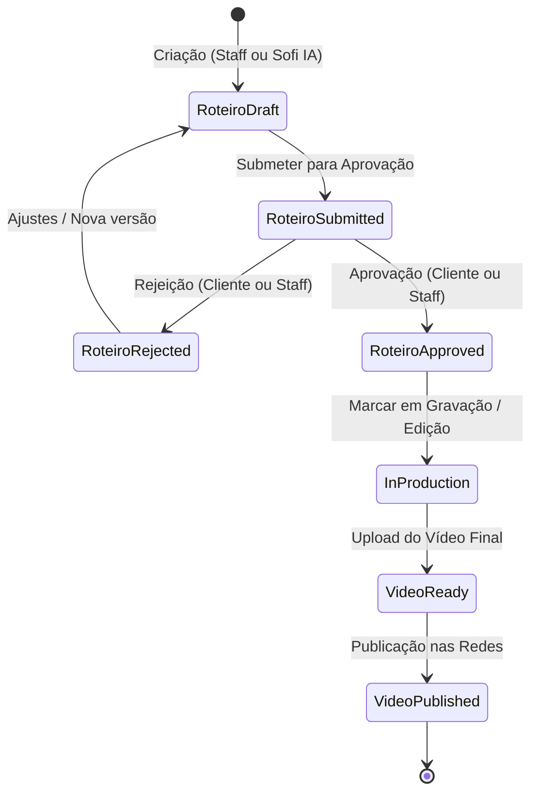

# Módulo Produções, Roteiros & Vídeos

**Responsabilidade:** Orquestrar todo o pipeline operacional de criação audiovisual da produtora, desde a abertura da demanda, geração e aprovação do roteiro, gravação e edição, até a entrega do vídeo final e publicação externa.

---

## 1. Dicionário de Dados

### `productions`
- `id`, `tenant_id`, `uuid`, `cliente_id`, `pack_purchase_id`, `created_by`, `title`, `description`, `status` (`planning`, `scripting`, `approved`, `in_production`, `review`, `completed`), `target_publication_date`, `seo_keywords`.
- Route Key: `uuid`.

### `roteiros`
- `id`, `tenant_id`, `uuid`, `production_id`, `created_by`, `approved_by` (staff), `approved_by_cliente_id` (cliente), `content`, `status` (`draft`, `submitted`, `approved`, `rejected`, `in_production`), `rejection_reason`, `submitted_at`, `approved_at`.
- Route Key: `uuid`.

### `videos`
- `id`, `tenant_id`, `production_id`, `title`, `description`, `video_url`, `thumbnail_url`, `duration_seconds`, `status` (`pending`, `ready`, `published`), `platform` (`youtube`, `instagram`, `tiktok`, `other`), `platform_video_id`, `published_at`, `sofi_seo_title`, `sofi_seo_description`, `sofi_hashtags` (array), `sofi_seo_keywords`, `sofi_seo_generated_at`.

### `showcase_videos`
- `id`, `tenant_id`, `title`, `description`, `video_url`, `thumbnail_url`, `category`, `sort_order`, `is_featured`.

---

## 2. Máquina de Estados e Ciclo de Vida



---

## 3. Principais Métodos de Domínio

### `Production.php`
- `isReadyForProduction()`: Retorna `true` se a produção estiver aprovada e possuir ao menos um roteiro com `status == 'approved'`.
- `approvedRoteiro()`: Retorna a coleção de roteiros aprovados.

### `Roteiro.php`
- `submit()`: Transiciona de `draft` para `submitted`.
- `approve(User $user)` / `approveByCliente(Cliente $cliente)`: Aprova o roteiro e registra o carimbo de data/hora e autor.
- `reject(User $user, string $reason)` / `rejectByCliente(Cliente $cliente, string $reason)`: Rejeita com justificativa.
- `markAsInProduction()`: Atualiza para `in_production`.

### `Video.php` & `ShowcaseVideo.php` (Trait `HasEmbeddableVideo`)
- `markAsReady()`: Marca o vídeo como pronto para revisão/download.
- `publish()`: Atualiza status para `published` e preenche `published_at = now()`.
- `youtube_id`: Extrai automaticamente IDs de URLs do YouTube (incluindo **YouTube Shorts** `youtube.com/shorts/{id}`, `watch?v=`, `youtu.be`).
- `vimeo_id`: Extrai ID de vídeos Vimeo.
- `video_type`: Identifica se o player deve ser `'youtube'`, `'vimeo'` ou `'direct'`.
- `embed_url`: Retorna URL pronta para `<iframe>` embed responsivo.
- `effective_thumbnail_url`: Retorna a thumbnail informada ou busca automaticamente a capa em alta resolução do YouTube (`img.youtube.com/vi/{id}/hqdefault.jpg`).

---

## 4. Integração de Rotas com `scopeBindings()`

Todas as rotas aninhadas em `routes/web.php` utilizam `Route::scopeBindings()`:

```php
Route::scopeBindings()->prefix('productions/{production}')->group(function () {
    Route::resource('roteiros', RoteiroController::class);
    Route::resource('videos', VideoController::class);
});
```
Isso garante que um ID de vídeo ou roteiro só será acessado se pertencer estritamente à produção especificada na URL.

---

## 5. Distribuição Multiplataforma & Publicação Automatizada

Para competir com soluções como Upload-Post e Ayrshare sem vendor lock-in, o ecossistema utiliza:

- **Contrato Agnóstico:** `App\Contracts\SocialPublisherContract`.
- **Driver Proxy Atual:** `App\Services\UploadPost\SocialDistributionService` consumindo `UploadPostClient` (white-label).
- **Webhooks Seguros:** `POST /webhooks/upload-post` com validação HMAC-SHA256 (`X-Upload-Post-Signature`) atualiza o status de `VideoPublication` para `publicado` em tempo real e finaliza o vídeo.
- **Isolamento Total:** `social_profiles` e `video_publications` implementam `BelongsToTenant` e autorização por `cliente_id`.

---

## 6. Notificações Sofi & Magic Links de Aprovação

- **`SofiVideoNotificationService`:** Orquestra disparos multicanal (E-mail e WhatsApp) notificando o cliente sobre o corte final pronto.
- **Magic Link (`/m/videos/{video}`):** Rota pública assinada com HMAC temporário (`14 dias`), autenticando o cliente com 1 toque sem necessidade de login/senha manual e redirecionando para a prévia de aprovação no portal.
- **Integração WhatsApp:** Gera mensagens ricas personalizadas com gancho de autoridade da Sofi, status de custódia (saldo de 50%) e link direto para WhatsApp Web/App.
- **Notificação Reversa & Fatura Oficial:** Quando o cliente aprova o corte e liquida o saldo, `VideoApprovalController` aciona `InvoiceService::issueAndNotify()` emitindo a fatura fiscal em PDF para o cliente e `SofiVideoNotificationService::notifyProducerVideoApproved()` alertando o editor e os administradores da produtora por e-mail com link direto para a esteira.

