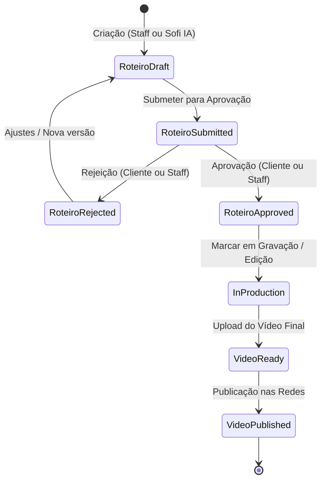

# Módulo Produções, Roteiros & Vídeos

**Responsabilidade:** Orquestrar todo o pipeline operacional de criação audiovisual da produtora, desde a abertura da demanda, geração e aprovação do roteiro, gravação e edição, até a entrega do vídeo final e publicação externa.

---

## 1. Dicionário de Dados

### `productions`
- `id`, `tenant_id`, `uuid`, `cliente_id`, `pack_purchase_id`, `created_by`, `title`, `description`, `status` (`planning`, `scripting`, `approved`, `in_production`, `review`, `completed`), `target_publication_date`, `seo_keywords`.
- Route Key: `uuid`.

### `roteiros`
- `id`, `tenant_id`, `uuid`, `production_id`, `created_by`, `approved_by` (staff), `approved_by_cliente_id` (cliente), `content`, `status` (`draft`, `submitted`, `approved`, `rejected`, `in_production`), `rejection_reason`, `submitted_at`, `approved_at`.
- Route Key: `uuid`.

### `videos`
- `id`, `tenant_id`, `production_id`, `title`, `description`, `video_url`, `thumbnail_url`, `duration_seconds`, `status` (`pending`, `ready`, `published`), `platform` (`youtube`, `instagram`, `tiktok`, `other`), `platform_video_id`, `published_at`, `sofi_seo_title`, `sofi_seo_description`, `sofi_hashtags` (array), `sofi_seo_keywords`, `sofi_seo_generated_at`.
- Arquivo hospedado na NUME (opcional, `video_url` passa a ser nullable): `source_disk` (disco privado `videos`), `source_path` (`{tenant}/{uuid}.mp4`), `source_mime`, `source_size`, `source_width`, `source_height`, `source_sha256`. Entrega só por URL assinada (`playbackUrl()`, `downloadUrl()`, `publicFetchUrl()` → rota `videos.media`); download e distribuição respeitam a custódia 50/50 (`isAssetLocked()`).

### `showcase_videos`
- `id`, `tenant_id`, `title`, `description`, `video_url`, `thumbnail_url`, `category`, `sort_order`, `is_featured`.

---

## 2. Máquina de Estados e Ciclo de Vida



---

## 3. Principais Métodos de Domínio

### `Production.php`
- `isReadyForProduction()`: Retorna `true` se a produção estiver aprovada e possuir ao menos um roteiro com `status == 'approved'`.
- `approvedRoteiro()`: Retorna a coleção de roteiros aprovados.

### `Roteiro.php`
- `submit()`: Transiciona de `draft` para `submitted`.
- `approve(User $user)` / `approveByCliente(Cliente $cliente)`: Aprova o roteiro e registra o carimbo de data/hora e autor.
- `reject(User $user, string $reason)` / `rejectByCliente(Cliente $cliente, string $reason)`: Rejeita com justificativa.
- `markAsInProduction()`: Atualiza para `in_production`.

### `Video.php` & `ShowcaseVideo.php` (Trait `HasEmbeddableVideo`)
- `markAsReady()`: Marca o vídeo como pronto para revisão/download.
- `publish()`: Atualiza status para `published` e preenche `published_at = now()`.
- `youtube_id`: Extrai automaticamente IDs de URLs do YouTube (incluindo **YouTube Shorts** `youtube.com/shorts/{id}`, `watch?v=`, `youtu.be`).
- `vimeo_id`: Extrai ID de vídeos Vimeo.
- `video_type`: Identifica se o player deve ser `'youtube'`, `'vimeo'` ou `'direct'`.
- `embed_url`: Retorna URL pronta para `<iframe>` embed responsivo.
- `effective_thumbnail_url`: Retorna a thumbnail informada ou busca automaticamente a capa em alta resolução do YouTube (`img.youtube.com/vi/{id}/hqdefault.jpg`).

---

## 4. Integração de Rotas com `scopeBindings()`

Todas as rotas aninhadas em `routes/web.php` utilizam `Route::scopeBindings()`:

```php
Route::scopeBindings()->prefix('productions/{production}')->group(function () {
    Route::resource('roteiros', RoteiroController::class);
    Route::resource('videos', VideoController::class);
});
```
Isso garante que um ID de vídeo ou roteiro só será acessado se pertencer estritamente à produção especificada na URL.

---

## 5. Distribuição Multiplataforma & Publicação Automatizada

Nume Social Engine: app próprio da NUME nas APIs oficiais de cada rede, com o Upload-Post como caminho para as redes ainda não aprovadas. Sem engenharia reversa.

- **Ponto único de disparo:** `App\Services\SocialPublishing\SocialPublicationService::distribute()` (portal, painel e agendador). Não chame `SocialDistributionService::publish()` direto de controller.
- **Roteamento por rede:** `SocialPublisherRouter` + `config('social.routing')`. A rede só vai para o nativo se estiver liberada (`native`) **e** o cliente tiver `SocialConnection` ativa nela; senão segue pelo Upload-Post. Vídeo que é só link nunca vai para o nativo. A rede também precisa de publicador em `config('social.native_publishers')` (hoje: YouTube, Instagram, Facebook, Threads, TikTok e LinkedIn). X e Pinterest ainda saem pelo Upload-Post.
- **Contas conectadas:** tabela `social_connections` (model `SocialConnection`, `BelongsToTenant`). Tokens com cast `encrypted` + `$hidden`; nunca em log, JSON ou view. Trocar a `APP_KEY` sem `APP_PREVIOUS_KEYS` invalida todos os tokens.
- **OAuth do YouTube:** `YouTubeConnector` + `OAuth\GoogleOAuthClient` (PKCE S256, `access_type=offline`, `prompt=consent`, escopos `youtube.upload` + `youtube.readonly`). O state fica na sessão, preso ao cliente, vale 10 min e uma única vez. Rotas `portal.social.oauth.redirect|callback` e `portal.social.connections.destroy` (desconectar revoga no Google).
- **Conectores (OAuth):** interface `Connectors\SocialConnector` registrada em `config('social.connectors')` (chave da rota: `youtube`, `meta`, `threads`, `tiktok`, `linkedin`) e `platform_connectors` (Instagram e Facebook saem do mesmo login `meta`). State via trait `ManagesOAuthState`. Para nova rede: conector + publicador + chave nas duas configs, sem mexer no controller.
- **Meta:** `MetaConnector` + `OAuth\MetaOAuthClient` (Graph fixa em `social.meta.graph_version`, token no header + `appsecret_proof`). Guarda só o **token da Página** (sem validade fixa, `expires_at` nulo); o Instagram profissional ligado à Página usa o mesmo token. Várias Páginas: lista criptografada na sessão até o cliente escolher (`MetaPageSelectionController`). Meta não tem revogação por usuário com token de Página: desconectar apaga localmente.
- **Threads:** `ThreadsConnector` + `OAuth\ThreadsOAuthClient` (graph.threads.com, token longo de 60 dias renovado com o próprio token). O vídeo vai por URL assinada (a API não aceita upload direto), então não funciona em `localhost`.
- **TikTok:** `TikTokConnector` + `OAuth\TikTokOAuthClient` (Login Kit v2; access 24 h, refresh 365 dias rotativo; desconectar revoga) e `TikTok\TikTokContentApi` (confere `error.code` mesmo com HTTP 200). O TikTok está em `config('social.composer_platforms')`: **nunca sai pelo modal genérico** nem pelo painel da produtora; o cliente publica pela tela `portal.videos.tiktok` (`TikTokComposerController`), que segue as regras de UX obrigatórias do Direct Post, e as escolhas vão em `resultado.tiktok`. `TikTok\TikTokPublisher` refaz o creator info antes de enviar, envia em partes (FILE_UPLOAD, só para `*.tiktokapis.com`) e acompanha o status. Sem auditoria: só "Somente eu" em conta privada e 5 usuários/dia.- **LinkedIn:** `LinkedInConnector` + `OAuth\LinkedInOAuthClient` (OpenID Connect + `w_member_social`, só perfil pessoal; Páginas exigem a Community Management API). Token de 60 dias **sem renovação** (refresh só para parceiros): vencido pede reconexão e o card avisa 7 dias antes; `social:refresh-tokens` não toca no LinkedIn. `LinkedIn\LinkedInVideoPublisher`: Videos API (partes com ETag, só `*.linkedin.com`) + Posts API, com `LinkedIn-Version` (`social.linkedin.api_version`) e legenda escapada no little text format.- **Publicadores:** `NativePublisher` por rede em `config('social.native_publishers')`: `YouTube\YouTubeUploader`, `Meta\InstagramReelsPublisher` (contêiner REELS resumable + rupload + espera FINISHED), `Meta\FacebookReelsPublisher` (start/upload/finish; valida 9:16 e 3–90 s antes) e `Meta\ThreadsVideoPublisher`. `Meta\MetaGraphPublisher` classifica os erros da Meta (190/10/2xx reconectar, 4/17/32/613 retentável, 9 limite diário). Legenda via `CaptionBuilder`; conta + arquivo validados por `HostedVideoSource`.
- **Envio nativo:** uma `VideoPublication` por rede (`driver`/`platform` = `youtube`, `social_connection_id`, `attempts`, `last_error`, `external_id`). O job `App\Jobs\PublishVideoToPlatform` recebe `tenant_id` no payload, é idempotente e roda na conexão de fila **`social-uploads`** (`retry_after` maior que o upload, senão o vídeo sai duplicado). `YouTube\YouTubeUploader` faz upload resumable do arquivo hospedado; a URL da sessão fica criptografada no cache, nunca em `resultado` (o portal devolve `resultado` ao cliente).
- **Tokens:** `SocialTokenManager` renova sob lock; `invalid_grant` marca a conta como `expired` (pede reconexão). `social:refresh-tokens` roda todo dia às 04:15 (Google se parado há 20 h, Threads a cada 7 dias; tokens de Página da Meta ficam de fora).
- **Erros:** `PublishException(reason, retryable)`. `last_error` guarda só o código curto (ex.: `quotaExceeded`, `reconnect_required`, `upload_interrupted`).
- **Drivers antigos:** `MetaGraphDriver`, `TikTokDriver` e `YouTubeDataDriver` estendem `PendingNativeDriver`: nunca marcam conta como conectada sem `social_connections`, nunca viram "publicado" sem confirmação e não usam token global de `env()`.
- **Upload-Post:** `SocialDistributionService` + `UploadPostClient` (white-label). `processScheduled()` só pega linhas com `driver = upload_post`; as nativas agendadas vão para a fila em `SocialPublicationService::dispatchDueNative()`.
- **Webhooks seguros:** `POST /webhooks/upload-post` com validação HMAC-SHA256 (`X-Upload-Post-Signature`).
- **Cota:** um envio com várias redes conta como uma distribuição (`Cliente::getDistributionsUsedCount()` agrupa linhas do mesmo vídeo criadas no mesmo envio).
- **Isolamento total:** `social_profiles`, `social_connections` e `video_publications` usam `BelongsToTenant`; portal confere `cliente_id`; job e comandos usam `forTenant()` / `tenant_id` explícito.

---

## 6. Notificações Sofi & Magic Links de Aprovação

- **`SofiVideoNotificationService`:** Orquestra disparos multicanal (E-mail e WhatsApp) notificando o cliente sobre o corte final pronto.
- **Magic Link (`/m/videos/{video}`):** Rota pública assinada com HMAC temporário (`14 dias`), autenticando o cliente com 1 toque sem necessidade de login/senha manual e redirecionando para a prévia de aprovação no portal.
- **Integração WhatsApp:** Gera mensagens ricas personalizadas com gancho de autoridade da Sofi, status de custódia (saldo de 50%) e link direto para WhatsApp Web/App.
- **Notificação Reversa & Fatura Oficial:** Quando o cliente aprova o corte e liquida o saldo, `VideoApprovalController` aciona `InvoiceService::issueAndNotify()` emitindo a fatura fiscal em PDF para o cliente e `SofiVideoNotificationService::notifyProducerVideoApproved()` alertando o editor e os administradores da produtora por e-mail com link direto para a esteira.

