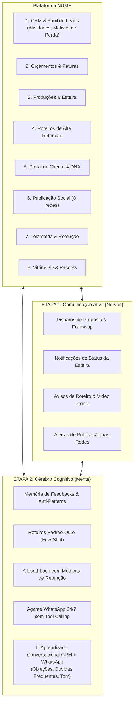

# Plano Estratégico & Arquitetural Unificado: Sofi WhatsApp CRM, Notificações & Aprendizado Cognitivo

> **Status:** Plano Estruturante Aprovado com Aprendizado Conversacional (CRM + WhatsApp)  
> **Data:** 29 de Outubro de 2026  
> **Escopo:** Integração total entre todas as ferramentas da plataforma NUME  
> **Arquitetura Base:** Laravel 12 + Laravel AI SDK (v1.3) + Laravel Boost (v2.10) + Meta Cloud API + Memory Layer

---

## 1. Visão Sistêmica: A Sofi em Todas as Ferramentas da NUME

Para não isolar funcionalidades em silos, o plano conecta a inteligência da **Sofi** a todas as ferramentas já existentes na plataforma, agora com **aprendizado retroalimentado pelas conversas de WhatsApp e dados comerciais do CRM**:

---

## 2. ETAPA 1 — O Sistema Nervoso de Comunicação Ativa (WhatsApp & E-mail Omnichannel)

**Objetivo:** Eliminar atritos e conectar todas as etapas operacionais e comerciais aos canais diretos do cliente (WhatsApp e E-mail), com geração automática de cópias pela Sofi.

### Como a Etapa 1 impacta cada ferramenta da NUME:

#### A. No Módulo de Orçamentos & CRM
- **Envio com 1 Clique na Tela do Orçamento (`quotes.show`):**
  - **E-mail Persuasivo (`QuoteProposalMail`):** A Sofi gera a copy destacando o objetivo estratégico do cliente, valor de investimento, anexo em PDF e link seguro para a página pública de aprovação (`/orcamento/{token}`).
  - **WhatsApp com 1 Clique (Web/Mobile):** Link `api.whatsapp.com` com mensagem formatada pela Sofi, já personalizada com o nome do cliente, resumo do projeto e link seguro.
- **Automação no Funil do CRM (`LeadAutomation` / `LeadService`):**
  - Ao disparar o orçamento, o `Lead` avança imediatamente de `qualificado` para **`proposta`** (ou `negociacao`).
  - É registrada uma atividade em `lead_activities` com timestamp e canal utilizado.

#### B. Na Esteira de Produções (Controle de Status)
- **Notificações por Mudança de Fase na Esteira:**
  - A cada transição de status em `productions/show.blade.php`:
    - `draft` → `in_production` (Gravação / Captação iniciada)
    - `in_production` → `editing` (Ilha de edição e color grading)
    - `editing` → `ready` (Pronto para revisão)
    - `ready` → `approved` (Aprovado pelo cliente)
    - `approved` → `published` (No ar nas redes)
- **Canais de Disparo:**
  - **E-mail Editorial (`ProductionStatusChangedMail`):** Design limpo, sem CSS inline, com barra de progresso visual da produção e botão de acesso direto.
  - **Central WhatsApp da Produção:** Botão "Abrir WhatsApp" com mensagem contextualizada da Sofi para manter o cliente empolgado com os bastidores.

#### C. Nos Roteiros e Entregáveis de Vídeo
- **Aviso de Roteiro Disponível:** Disparo para o cliente revisar a narrativa nos primeiros 3 segundos.
- **Aviso de Corte Final Pronto (`SofiVideoNotificationService` integrado):**
  - Link mágico de 14 dias para assistir sem senha.
  - Se houver custódia 50/50, aviso transparente de liberação de download em 4K e publicação social na aprovação.

#### D. Na Publicação Social & Vitrine
- **Aviso de "Vídeo no Ar":** Notificação assim que o job `PublishVideoToPlatform` conclui o envio para Instagram, YouTube, TikTok, etc., convidando o cliente a interagir nas primeiras horas.

---

## 3. ETAPA 2 — O Cérebro Cognitivo da Sofi & Agente WhatsApp 24/7 (Memória, Aprendizado CRM/WhatsApp & Ação)

**Objetivo:** Transformar a Sofi de um modelo seq2seq estático em uma consultora estratégica que **aprende com os feedbacks passados, com os dados comerciais do CRM e com as conversas reais do WhatsApp**, além de **agir no WhatsApp com ferramentas reais (Tool Calling)**.

### Como a Etapa 2 impacta cada ferramenta da NUME:

#### A. Aprendizado Conversacional & Comercial (CRM + WhatsApp)
A Sofi passa a escutar ativamente as interações comerciais para afinar suas respostas e roteiros:

1. **Aprendizado com os Dados do CRM (`Lead`, `LeadActivity`, `lost_reason`):**
   - **Objeções Reais do Mercado:** Quando um lead é marcado como `perdido` com o motivo preenchido (ex: *"achou o prazo de 15 dias longo"*, *"não entendeu a diferença entre Reels e Vídeo Horizontal"*, *"preço fora do orçamento"*), a Sofi sintetiza as principais barreiras de compra daquela produtora.
   - **Antecipação em Propostas:** Ao redigir novos orçamentos, a Sofi insere blocos persuasivos que **quebram preventivamente essas objeções** antes mesmo do cliente perguntar.
2. **Aprendizado com as Conversas do WhatsApp (`whatsapp_messages`):**
   - **Dúvidas Recorrentes (FAQ Dinâmico):** Perguntas feitas com frequência no WhatsApp (ex: *"vocês gravam na minha empresa?"*, *"o teleprompter está incluso?"*) são agrupadas em um repositório dinâmico de conhecimento da produtora.
   - **Estilo de Linguagem do Cliente:** A Sofi identifica se o cliente prefere respostas curtas e diretas, linguagem corporativa formal ou tom descontraído, espelhando o padrão de comunicação para maximizar a empatia.
3. **Aprendizado com Feedbacks de Produção (Anti-Patterns e Padrão-Ouro):**
   - Regras destiladas de críticas de roteiro (*"nunca usar a palavra barato"*, *"evitar termos técnicos em inglês"*).
   - Roteiros aprovados de primeira injetados como referências *Few-Shot*.
4. **Retroalimentação da Telemetria (`TelemetryService`):**
   - Formatos com maior retenção de audiência nas redes sociais passam a ter prioridade na criação de pautas editoriais.
5. **Painel "Cérebro da Marca" (Portal do Cliente & Produtora):**
   - Visão centralizada onde a produtora e o cliente visualizam:
     - As preferências aprendidas.
     - As objeções comuns mapeadas.
     - Botão para adicionar ou corrigir regras manualmente (Human-in-the-Loop).

#### B. Agente WhatsApp 24/7 (Meta Cloud API — Arquitetura do Vídeo)
Implementação do agente de conversação ativa no WhatsApp oficial da produtora:

1. **Webhook Oficial Meta (`/webhooks/whatsapp`):**
   - Validação de verify token e HMAC SHA-256.
   - Recepção de mensagens de leads e clientes em fila assíncrona.
2. **Memória de Conversa de Longo Prazo:**
   - Tabela `whatsapp_messages` armazenando histórico para alimentar o `SofiWhatsAppAgent` via método `messages()`.
3. **Ferramentas Ativas (Tool Calling) conectando toda a NUME:**
   - `SendQuoteTool`: Envia o link da proposta pública `/orcamento/{token}`.
   - `CheckProductionStatusTool`: Consulta a esteira e responde em que pé está o vídeo.
   - `ListTenantPacksTool`: Consulta os pacotes e preços oficiais na vitrine da produtora.
   - `MoveLeadStageTool`: Move o lead para `negociacao` no CRM quando ele demonstra interesse.
   - `OpenSupportTicketTool`: Abre chamado de suporte no CRM se houver dúvida complexa.
   - `ScheduleMeetingTool`: Disponibiliza link de agendamento de briefing com a equipe.
4. **Régua de Follow-up Inteligente:**
   - Job agendado `FollowUpPendingQuotesJob` (diário às 10h): se o orçamento foi enviado e não houve resposta em 24h/48h, a Sofi envia um lembrete educado no WhatsApp para tirar dúvidas.

---

## 4. Matriz de Entregáveis das 2 Etapas

| Entregável | Etapa 1 (Comunicação Ativa) | Etapa 2 (Cérebro Cognitivo & Bot) |
| :--- | :---: | :---: |
| **Envio de Orçamento E-mail & WhatsApp** | ✓ | — |
| **Avanço Automático de Leads no CRM** | ✓ | — |
| **Notificações de Status de Produção (E-mail/WhatsApp)** | ✓ | — |
| **Central de Disparo na tela de Produções** | ✓ | — |
| **Tabela de Memória Cognitiva (`client_ai_memories`)** | — | ✓ |
| **Aprendizado com Dados do CRM (Objeções/Perdas)** | — | ✓ |
| **Aprendizado com Conversas de WhatsApp (Dúvidas/Tom)** | — | ✓ |
| **Agente de Destilação de Feedbacks (Sofi Reflection)** | — | ✓ |
| **Injeção de Anti-Patterns no `SofiScriptAgent`** | — | ✓ |
| **Retroalimentação de Métricas da Telemetria** | — | ✓ |
| **Painel "Cérebro da Marca" no Portal e na Produtora** | — | ✓ |
| **Webhook Meta Cloud API (`/webhooks/whatsapp`)** | — | ✓ |
| **Sofi WhatsApp Agent com Tool Calling** | — | ✓ |
| **Follow-up Automático de Orçamentos (24h/48h)** | — | ✓ |

---

## 5. Roteiro de Execução Técnica & Status de Implementação

1. **Etapa 1 — Comunicação Ativa (100% Implementada & Testada):**
   - [x] Criação de `SofiProductionNotificationService` com suporte a todos os status da esteira.
   - [x] Mailable e template Blade limpo para e-mail transacional (`ProductionStatusChangedMail`).
   - [x] Card da Sofi na view de Produções com envio de e-mail e atalho direto para WhatsApp com mensagem personalizada.
   - [x] Envio de propostas de orçamento via WhatsApp e e-mail com avanço automático do funil do CRM (`SofiQuoteNotificationService`).
   - [x] Testes de feature automatizados aprovados: `ProductionStatusNotificationTest` e `QuoteNotificationAndCrmTest`.

2. **Etapa 2 — Cérebro Cognitivo & WhatsApp Meta Cloud API (100% Implementada & Testada):**
   - [x] Migration e model `ClientAiMemory` com `BelongsToTenant` para aprendizado contínuo por cliente e produtora.
   - [x] Agente/Serviço de destilação cognitiva (`SofiMemoryDistillationService`):
     - Aprendizado com aprovação (exemplares de sucesso) e rejeição de roteiros (anti-patterns) no portal do cliente.
     - Aprendizado com motivos de perda comercial no CRM (`Lead::lost_reason`).
     - Aprendizado com dúvidas frequentes e objeções em conversas de chat (Portal, Vitrine e WhatsApp).
   - [x] Injeção da memória cognitiva no `SofiCopywriterService` e no `SofiSupportChatAgent`.
   - [x] Endpoint Webhook da Meta Cloud API (`GET/POST /webhooks/whatsapp`) com verificação de token, idempotência e CSRF isento.
   - [x] `SofiWhatsAppAgent` implementado no Laravel AI SDK com Tool Calling (`CheckProductionStatusTool`, `ListTenantPacksTool`) e gravação automática no CRM.
   - [x] Testes de feature automatizados aprovados: `SofiCognitiveMemoryTest` e `WhatsAppWebhookAndAgentTest`.
   - [x] Todos os 13 testes das duas etapas 100% aprovados e formatados com o Laravel Pint.
