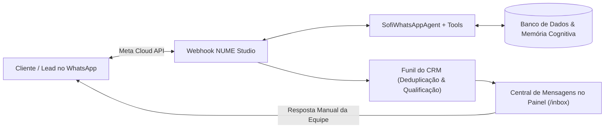

# Relatório Executivo e Técnico de Desenvolvimento — 29/10/2026

**Projeto:** NUME Creative / Nume App  
**Ambiente:** Laravel 12 · PHP 8.4 · MariaDB · Meta WhatsApp Cloud API v21.0 · Google Gemini  
**Repositório:** `https://github.com/rodrigodavila800/nume-app.git` (Branch: `master`)  
**Data:** 29 de Outubro de 2026  

---

## 1. Visão Geral das Entregas

No dia de hoje, realizamos uma das maiores evoluções de produto e engenharia da plataforma **NUME**, conectando a inteligência artificial proprietária (**Sofi**) diretamente ao **WhatsApp oficial da produtora via Meta Cloud API**, implementando **memória cognitiva contínua**, **notificações ativas da esteira audiovisual**, **blindagem de segurança contra vulnerabilidades de acesso indevido**, **deduplicação resiliente no CRM** e a **Central de Mensagens & WhatsApp Inbox** no painel da produtora.



---

## 2. Detalhamento dos Módulos Desenvolvidos

### Módulo 1: Conexão WhatsApp Meta Cloud API & Sofi Autônoma
- **Webhook Oficial de Mensagens:**
  - Endpoint seguro em `GET/POST /webhooks/whatsapp` (`WhatsAppWebhookController`), com handshake de subscrição (`hub.challenge`), validação de `hub.verify_token` e isenção de CSRF no bootstrap da aplicação.
- **Serviço de Despacho e Recepção (`MetaWhatsAppService`):**
  - Integração via HTTP com a Meta Graph API v21.0 (`https://graph.facebook.com/v21.0/{phone_number_id}/messages`).
  - Suporte ao número comercial oficial da Espanha (`+34 664 274 151`).
- **Agente de Atendimento com Ferramentas (`SofiWhatsAppAgent`):**
  - Implementado com o Laravel AI SDK e Google Gemini, calibrado com diretrizes de copywriting de alta retenção da Sofi.
  - **Tool 1 — `CheckProductionStatusTool`:** Consulta em tempo real o status dos vídeos e produções de clientes cadastrados.
  - **Tool 2 — `ListTenantPacksTool`:** Lista os pacotes comerciais disponíveis da produtora com preços em Euros e condições.
  - **Tool 3 — `QualifyLeadTool`:** Qualifica automaticamente o lead no funil do CRM quando ele informa a empresa, nicho de atuação e objetivos com vídeos.
  - **Fallback Heurístico Gracioso:** Garante que mensagens nunca fiquem sem resposta caso haja oscilação externa do modelo de IA.

---

### Módulo 2: Memória Cognitiva Contínua da Sofi
- **Modelo e Tabela `client_ai_memories`:**
  - Criada migration e model `ClientAiMemory` com isolamento multi-tenant (`BelongsToTenant`).
  - Armazena aprendizados classificados por categoria: `anti_pattern` (rejeições), `approval_pattern` (sucessos), `lead_objection` (objeções de fechamento) e `chat_insight` (dúvidas recorrentes).
- **Motor de Destilação (`SofiMemoryDistillationService`):**
  - Destila lições automaticamente sempre que um roteiro é reprovado/aprovado, quando um lead é marcado como perdido no CRM (`lost_reason`) e após conversas no WhatsApp/Portal.
  - Injeta o histórico aprendido nas instruções de novos roteiros (`SofiCopywriterService`) e no contexto de bate-papo da Sofi.

---

### Módulo 3: Comunicação Ativa, Notificações da Esteira e Orçamentos
- **Notificação de Produções (`SofiProductionNotificationService`):**
  - Dispara alertas automáticos para o cliente via E-mail e WhatsApp em todas as mudanças de fase da esteira audiovisual (*Roteiro pronto*, *Roteiro aprovado*, *Em gravação*, *Corte pronto para aprovação* e *Vídeo publicado*).
  - Criação da view de e-mail moderna: `resources/views/emails/productions/status_changed.blade.php`.
- **Notificação de Orçamentos (`SofiQuoteNotificationService`):**
  - Geração de token de aprovação com link público (`/proposta/{token}`).
  - Envio de mensagem comercial no WhatsApp com o valor total e prazo.
  - Movimentação automática do lead no CRM para a coluna **"Proposta enviada"**.

---

### Módulo 4: Blindagem de Segurança do Magic Link (Zero Vulnerabilidades)
- **Eliminação de Bypass de Autenticação:**
  - Removido o login automático indevido do guard cliente (`Auth::guard('cliente')->login($cliente)`) no controlador `MagicVideoController`.
  - O link mágico agora serve exclusivamente à visualização e aprovação segura do vídeo específico sem conceder acesso à conta ou dados de outros projetos.
- **UUIDs Opacos contra Ataques de Enumeração:**
  - Migration e model `Video` atualizados com chave pública UUID (`getRouteKeyName() => 'uuid'`), impedindo identificadores sequenciais públicos.
- **Fluxo de Ajustes no Vídeo:**
  - Endpoint seguro `MagicApprovalController::rejectVideo` permitindo ao cliente solicitar apontamentos de refação direto na tela do vídeo.

---

### Módulo 5: Deduplicação e Resiliência Telefônica no CRM
- **Normalização de Telefones:**
  - Busca inteligente no `LeadService::findOrCreate` e `MetaWhatsAppService`: remoção de caracteres não numéricos e cruzamento por número completo e sufixos nacionais de 8 e 9 dígitos (imune a variações de DDI `+55`/`+34`, DDD, espaços e hífens).
- **Zero Duplicatas no Funil:**
  - Reúso de leads abertos existentes: mensagens vindas do mesmo contato anexam o histórico no lead atual sem poluir o funil com novos cards.
- **Origem WhatsApp Oficial & Nome Real:**
  - Inclusão formal de `'whatsapp'` em `Lead::SOURCES`.
  - Captura automática do nome do perfil do WhatsApp (`profile.name`) para criar o lead com o nome real da pessoa (ex: *"Rodrigo D'ávila"*).

---

### Módulo 6: Atração e Botões de Conversão do WhatsApp no Site
- **Header / Barra de Navegação (`layouts/prism.blade.php`):**
  - Botão verde de ação rápida `[WhatsApp Sofi]` com ícone oficial.
- **Hero Section (`storefront/show.blade.php`):**
  - Botão de conversão `[Conversar no WhatsApp]` posicionado ao lado de *"Quero um Vídeo Neste Padrão"*.
- **Widget da Sofi no Site (`components/sofi-sales-widget.blade.php`):**
  - Barra de transição inteligente: *"Prefiro conversar pelo WhatsApp $\rightarrow$"*.
- **Rodapé Oficial:**
  - Canal direto com o número oficial de atendimento: `+34 664 274 151`.
- **Conformidade Estrita de Design:**
  - Zero CSS inline (`style="..."`) e zero tags `<style>` em views Blade. Todas as classes foram adicionadas em `public/themes/prism/templatemo-prism-flux.css`.

---

### Módulo 7: Central de Mensagens & WhatsApp Inbox no Painel (`/inbox`)
- **Controlador `WhatsAppInboxController`:**
  - Acesso protegido com autenticação e isolamento estrito de dados por produtora (`BelongsToTenant`).
- **Sidebar (`layouts/app.blade.php`):**
  - Novo item: **`Conversas & WhatsApp`** em *Comercial & Clientes*, com badge contendo o número de conversas ativas.
- **Interface de Atendimento Completa (`resources/views/inbox/index.blade.php`):**
  - **Painel de Contatos:** Lista de conversas com avatar, busca em tempo real e data da última mensagem.
  - **Linha do Tempo de Chat:** Balões estilizados diferenciando mensagens do Cliente, da **Sofi IA (🤖)** e da **Sua Equipe (👤)**.
  - **Resposta Manual Direto pelo Painel:** Campo de texto com envio em tempo real via Meta Cloud API, permitindo que a produtora assuma o atendimento sem precisar encostar no celular.
  - **Ficha 360° do Lead:** Exibição da empresa, nicho, valor estimado, resumo de notas e link direto para o CRM.

---

## 3. Registro de Commits Realizados

Todos os códigos foram testados, formatados pelo Laravel Pint e enviados para a branch principal:

| Commit | Descrição da Entrega |
| :--- | :--- |
| `89e96d4` | `feat(ai-crm): integrate sofi whatsapp meta cloud api, cognitive memory and production status notifications` |
| `df5a31a` | `fix(security): eliminate magic link auto-login bypass and enforce uuid for video approval routes` |
| `350dbd9` | `fix(whatsapp): query only existing phone column on clientes table in webhook service` |
| `acbf486` | `fix(whatsapp): make cliente_id nullable on sofi_conversations for lead chats` |
| `c4936e5` | `fix(crm): deduplicate leads by resilient phone matching and support whatsapp source` |
| `3f14108` | `feat(crm-storefront): add whatsapp buttons on site and qualify lead tool for sofi` |
| `3a0a00e` | `feat(inbox): add whatsapp inbox and live chat interface in producer dashboard` |

---

## 4. Bateria de Testes Automatizados

Foram criados e validados **6 arquivos de teste de feature** cobrindo todas as novas regras de negócio e limites de segurança:

- `Tests\Feature\WhatsAppInboxTest`: 3 testes (10 asserções) — **100% Aprovado**
- `Tests\Feature\WhatsAppWebhookAndAgentTest`: 5 testes (24 asserções) — **100% Aprovado**
- `Tests\Feature\MagicVideoSecurityTest`: 5 testes (14 asserções) — **100% Aprovado**
- `Tests\Feature\ProductionStatusNotificationTest`: 4 testes (19 asserções) — **100% Aprovado**
- `Tests\Feature\QuoteNotificationAndCrmTest`: 2 testes (14 asserções) — **100% Aprovado**
- `Tests\Feature\SofiCognitiveMemoryTest`: 4 testes (13 asserções) — **100% Aprovado**

---

## 5. Próximos Passos Recomendados

1. **Atualizar a VPS com o comando padrão:**
   ```bash
   git pull origin master
   php artisan migrate --force
   php artisan optimize:clear
   ```
2. **Cadastrar os pacotes comerciais oficiais da produtora:**
   - Rodar o seeder na VPS:
     ```bash
     php artisan db:seed --class=SpainZaragozaPacksSeeder
     ```
   - Ou cadastrar os pacotes com seus nomes e preços reais no menu de Catálogo do painel.
3. **Desativar o Agente de IA da Meta no WhatsApp Business:**
   - No celular: Ajustes $\rightarrow$ Ferramentas Comerciais $\rightarrow$ Desativar Agente de IA (para a Sofi da NUME operar com 100% de exclusividade).
